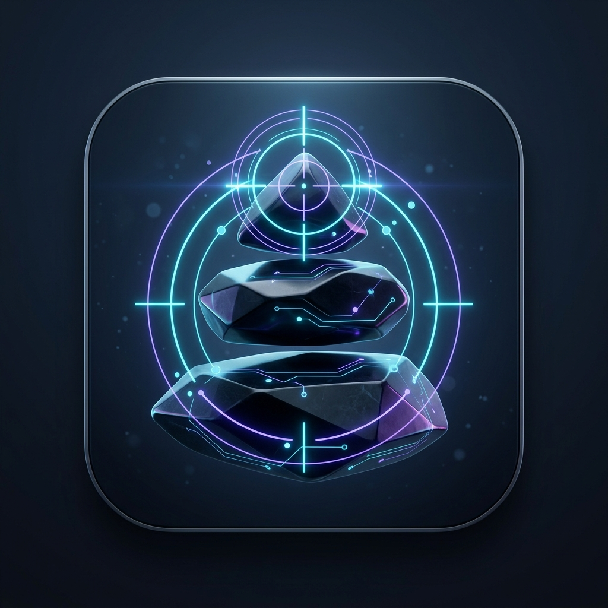

<p align="center">
  
</p>

<h1 align="center">ScopeCairn</h1>

<p align="center">
  <strong>Local-first codebase intelligence &amp; task scope guard for AI coding agents.</strong><br>
  <em>Understand before exploring. Retrieve before reading.</em>
</p>

<p align="center">
  <a href="https://nodejs.org"></a>
  <a href="LICENSE"></a>
  
  
</p>

---

Local-first codebase intelligence layer for AI coding agents.
Understand the codebase, then give the agent only what it needs:
a knowledge graph of the repository, the relevant context per task,
change impact analysis, and enforced minimal-work scope.
No MCP server, no embeddings, no network calls, no telemetry.

> Understand before exploring. Retrieve before reading.

## Features

- **Knowledge graph** — files, symbols (functions, classes, methods,
  interfaces, components, routes, models…), and typed relations
  (`IMPORTS`, `CALLS`, `EXTENDS`, `TESTS`, `ROUTES_TO`, `QUERIES`…)
  in local SQLite, fully deterministic. Parsing uses Tree-sitter
  grammars (bundled WASM); schema files without a grammar keep an
  explicit fallback.
- **Graph retrieval, no embeddings** — token-matched seeds → weighted
  expansion → 5-signal ranking (seed, proximity, centrality, git
  recency, co-change). Weights configurable, calibrated by benchmark.
- **Task scope control** — every complex task returns Required /
  Optional / Protected file lists plus Task Guard rules and a
  Definition of Done, so the agent changes only what matters.
- **Change impact** — direct, indirect (2-hop), tests, and UI components
  affected by a file or symbol.
- **Call path tracing** — `scopecairn graph <A> --to <B>` shows the shortest
  multi-hop call/dependency chain between two symbols.
- **Centrality ranking** — weighted PageRank + betweenness cached per
  symbol; `context` surfaces critical hotspots, `status --doctor` flags
  single points of failure.
- **Community detection** — Louvain clustering finds real modules by
  link density (not just folders); `graph` shows each symbol's community.
- **Cycle detection** — Tarjan SCC finds circular dependencies;
  reported by `status --doctor` and `verify`, warned in `context`, listed in `GRAPH.md`.
- **Auto-refresh** — `context` and `impact` re-index changed files first;
  run `scan` after editing to close the loop.
- **Framework adapters** — Next.js (App + Pages Router routes),
  Prisma models, Drizzle tables/queries, Express, FastAPI, NestJS (controllers, routes, injectables), Django (urls, models), SQLAlchemy, and Vue SFC detected automatically.
- **Multi-language** — TypeScript, JavaScript, Python, Java, Go, Rust,
  PHP, C#, C/C++, Ruby, HTML, Vue SFC (plus config/schema files as
  graph nodes).
- **Multi-agent setup** — skills for Claude Code (project skill),
  Antigravity, Cursor, Windsurf, Copilot, Kiro, and an OpenCode
  slash command. ScopeCairn never touches your `AGENTS.md`/`CLAUDE.md` —
  those hold your repo's details, not tool instructions.
- **`GRAPH.md` knowledge file** — `.scopecairn/GRAPH.md` is a budgeted
  (±150 lines) frozen summary of the graph (modules, most-used symbols,
  PageRank hotspots, circular dependencies, routes, models, protected).
  Written on setup, rewritten only when the
  graph changes — for cold-start orientation; per-task precision still
  comes from `context`. `.scopecairn/ARCHAEOLOGY.md` (purely from local
  `git log`: top author, bus factor, churn) is written once; delete it to
  regenerate.
- **`GRAPH.html` visual explorer** — offline, dependency-free Canvas
  explorer written next to `GRAPH.md` on every graph change.
  Cluster ↔ File ↔ Symbol hierarchy toggle, live search, type filter,
  click-for-details side panel (callers, callees, centrality scores).
  Nodes sized by symbols/PageRank, colored by Louvain community.
  Pan, zoom, hover inspect. Double-click to open, no server.
- **Graph export for external tools** — `scopecairn graph --export
  mermaid|graphml|dot|json` writes `.scopecairn/graph.<ext>` for PR
  diagrams (Mermaid), Gephi/Cytoscape (GraphML), Graphviz (DOT),
  or custom scripts (JSON).

## Install

```bash
npm install -g scopecairn
```

Requires Node.js ≥ 20.

Upgrade later with:

```bash
npm install -g scopecairn@latest
```

## Agent-driven setup

Install once, then just type `scopecairn ./` to your AI agent —
it runs project setup itself.

1. Install the skill once (global):
   ```bash
   npx skills add <github-user>/scopecairn -g
   ```
   (fallback without a skill: add one line to your global agent
   instructions — `~/.claude/CLAUDE.md` or equivalent: _When the user
   writes "scopecairn \<path\>", run `scopecairn init \<path\>`._)
2. In any project chat, type:
   ```
   scopecairn ./
   ```
   The agent runs `scopecairn init ./`, reports files indexed and
   integration files written. Approve the terminal command once;
   afterwards, add the printed allowlist so later calls need no approval.

## Quickstart (manual)

```bash
cd your-repo
scopecairn init      # index + Antigravity Skill + Workflow
```

Claude Code (project skill, committed with the repo):

```bash
scopecairn claude install
```

After setup, your agent calls ScopeCairn automatically on every coding task.
To query manually (replace `src/indexer.ts` or `buildContext` with files/symbols from your codebase):

```bash
scopecairn scan                             # index repository (--rebuild, --clean, --watch)
scopecairn context "tambah fitur auth"      # AI agent task context + scope
scopecairn impact src/indexer.ts            # blast radius & affected tests (--run-tests)
scopecairn graph buildContext               # inspect relations, path (--to), export (--export)
scopecairn verify                           # pre-commit safety guard (--diff, --arch)
scopecairn status                           # index statistics & health checks (--doctor, --html)
scopecairn read symbol indexFileSymbols     # symbol-level source excerpt
```

Per-agent installers (instead of `init --agents …`):

```bash
scopecairn antigravity install   # Skill + Workflow + allowlist guide
scopecairn claude install        # project skill .claude/skills (also: cursor, windsurf, copilot)
scopecairn kiro install          # steering .kiro/steering + knowledge skill .kiro/skills/scopecairn-knowledge
scopecairn opencode install      # /scopecairn slash command + permission snippet
scopecairn claude uninstall      # clean removal, user content preserved
scopecairn agents list
```

## 6 Core Commands

ScopeCairn organizes its capabilities into **6 core commands** aligned with codebase architecture:

| Core Command | Description & Key Options |
| ------------ | ------------------------- |
| `scan` | **Index & Database Lifecycle:** Index repository. Options: `--rebuild` (rebuild from scratch), `--clean` (remove `.scopecairn/`), `--watch` (auto-refresh daemon on file save). |
| `context "<task>"` | **AI Agent Context & Scope:** Main agent entry point with auto-refresh, task classification, relevant context, task scope, and Task Guard. Options: `--escalate`, `--mode NORMAL\|FAST\|SAFE\|AUDIT`, `--max-tokens N`, `--no-history`, `--with-diff`, `--json`. |
| `impact <target>` | **Blast Radius & Test Selection:** Change impact analysis across direct, indirect, tests, UI components, and API clients. Options: `--run-tests` (run affected tests directly), `--tests` (list affected tests only), `--repos [list]` (cross-repo blast radius). |
| `graph [symbol]` | **Knowledge Graph & Navigation:** Symbol relations, PageRank centrality, community clusters, and cycle status. Options: `--to <target>` (shortest multi-hop call path), `--export <fmt>` (`mermaid\|graphml\|dot\|json`). |
| `verify` | **Pre-Commit Safety Guard:** Working tree check against protected files, task scope creep, and circular dependency regressions. Options: `--diff` (structural symbol-level diff vs HEAD), `--arch` (architectural layer rules), `--strict`, `--task <t>`. |
| `status` | **Health & Diagnostics:** Index statistics and metadata. Options: `--doctor` (integration and adapter health check), `--verbose`, `--html` (generate local HTML dashboard). |

### Helper & Setup Commands

| Command | Description |
| ------- | ----------- |
| `init [path]` | Initial indexing + Skill, Workflow, detected agent skills (`--agents …\|all`). |
| `read symbol <name>` | Symbol-level source excerpt (not whole files). |
| `benchmark [--tune]` | Retrieval recall, irrelevant ratio, context reduction + weight tuning (dev-only, hidden from `--help`). |
| `<agent> install` | Agent installers: `antigravity`, `claude`, `cursor`, `windsurf`, `copilot`, `kiro`, `opencode`. |

> [!NOTE]
> **Backward Compatibility:** All previous standalone commands (`rebuild`, `clean`, `watch`, `doctor`, `dashboard`, `test-select`, `path`, `export`, `diff`, `arch-check`, `history`) are preserved as hidden aliases mapped directly into these 6 core commands — they still work but no longer appear in `--help`. `update` is deprecated (use `npm install -g scopecairn@latest`).

Agent commands (`context`, `impact`, `read`, `graph`, `status`, `verify`)
are read-only toward source code and safe to allowlist. `init` and `scan`
are user-side setup/lifecycle commands.

## Framework adapters

Detected automatically during `scan` (shown in output and `status`).
No configuration needed.

| Adapter      | Detects                                            | Produces                                                                                                                                             |
| ------------ | -------------------------------------------------- | ---------------------------------------------------------------------------------------------------------------------------------------------------- |
| `nextjs`     | `app/`, `pages/`, `next.config.*`                  | Route symbols (`GET /api/x`, `PAGE /y` incl. route groups, dynamic segments), `ROUTES_TO` handler edges, `QUERIES` handler→model edges               |
| `prisma`     | `schema.prisma`                                    | `model` symbols for `QUERIES` resolution                                                                                                             |
| `drizzle`    | `drizzle*` paths/config, `db/` schemas             | `model` symbols from `pgTable`/`sqliteTable`/`mysqlTable`; `QUERIES` from `db.query.*` relational and `db.select/insert/update/delete` builder calls |
| `express`    | `package.json` deps                                | Route symbols from `app/router.METHOD(path)`, handler edges                                                                                          |
| `fastapi`    | `.py` routes, requirements/pyproject               | Route symbols from `@app.METHOD("/path")` decorators                                                                                                 |
| `nestjs`     | `*.controller.ts`, `*.service.ts`, `nest-cli.json` | Route symbols from `@Controller` and `@Get/@Post/...` decorators, `ROUTES_TO` handler edges, `@Injectable()` service providers                       |
| `django`     | `manage.py`, `urls.py`, `models.py`                | Route symbols from `path()`/`re_path()` in `urls.py`, `ROUTES_TO` handler edges, `model` symbols from `models.Model`                                 |
| `sqlalchemy` | requirements/pyproject                             | `model` symbols from `class X(Base)`/`__tablename__`; `QUERIES` from `session.query/select`                                                          |
| `vue`        | `.vue` SFCs, `package.json` deps                   | `component` symbols per SFC; `IMPORTS` edges from used components in template                                                                        |

Limits (honest): non-Prisma/Drizzle/SQLAlchemy ORMs, inter-table
references, raw SQL strings, and fully dynamic table names are not mapped
yet — those edges are skipped (and logged to `.scopecairn/last-run.log`),
never hallucinated. Server Actions (`detectServerActions`) and middleware
(`detectMiddleware`) are detected in `nextjs.ts`. QUERIES re-derive on
every scan so new models resolve without a rebuild.
Contributing a new adapter = one file + one registration line
in `src/adapters/index.ts` (see `FrameworkAdapter` in `src/adapters/types.ts`).

## Typical loop

```
prompt → scopecairn context (refresh at start) → agent edits code
       → scopecairn scan (refresh at end, incremental, ~instant)
```

Measure retrieval quality anytime: `scopecairn benchmark [--tune]`.

## History privacy

`scan` mengindeks pesan commit git lokal ke tabel `commits`/`commit_files` di
`.scopecairn/scopecairn.db` (dilewati commit >40 file, lockfile, dan generated).
Isi commit **tidak** masuk `GRAPH.md`/`GRAPH.html`/`graph --export` (sering di-commit dan
dibagikan) — riwayat hanya hidup di database lokal dan output `context`.
Pesan commit bisa memuat info sensitif; karena tidak keluar dari mesin, risikonya
kecil. Repo tanpa git atau clone dangkal tetap didukung (riwayat parsial/absen,
dilaporkan `status --doctor`).

## License

MIT — see [LICENSE](./LICENSE).
