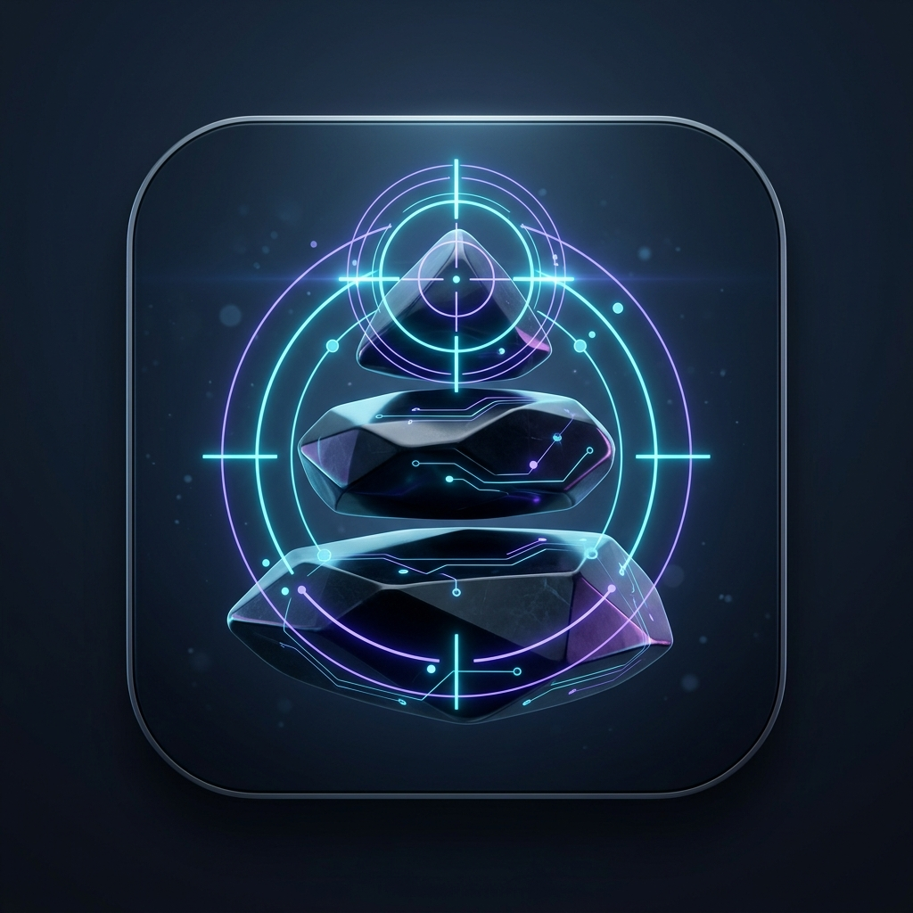

<p align="center">
  
</p>

<h1 align="center">ScopeCairn</h1>

<p align="center">
  <strong>Local-first codebase intelligence &amp; task scope guard for AI coding agents.</strong><br>
  <em>Understand before exploring. Retrieve before reading.</em>
</p>

<p align="center">
  <a href="https://nodejs.org"></a>
  <a href="LICENSE"></a>
  
  
</p>

---

Local-first codebase intelligence layer for AI coding agents.
Understand the codebase, then give the agent only what it needs:
a knowledge graph of the repository, the relevant context per task,
change impact analysis, and enforced minimal-work scope.
No MCP server, no embeddings, no network calls, no telemetry.

> Understand before exploring. Retrieve before reading.

## Features

- **Knowledge graph** — files, symbols (functions, classes, methods,
  interfaces, components, routes, models…), and typed relations
  (`IMPORTS`, `CALLS`, `EXTENDS`, `TESTS`, `ROUTES_TO`, `QUERIES`…)
  in local SQLite, fully deterministic. Parsing uses Tree-sitter
  grammars (bundled WASM); schema files without a grammar keep an
  explicit fallback.
- **Graph retrieval, no embeddings** — token-matched seeds → weighted
  expansion → 5-signal ranking (seed, proximity, centrality, git
  recency, co-change). Weights configurable, calibrated by benchmark.
- **Task scope control** — every complex task returns Required /
  Optional / Protected file lists plus Task Guard rules and a
  Definition of Done, so the agent changes only what matters.
- **Change impact** — direct, indirect (2-hop), tests, and UI components
  affected by a file or symbol.
- **Call path tracing** — `scopecairn graph <A> --to <B>` shows the shortest
  multi-hop call/dependency chain between two symbols.
- **Centrality ranking** — weighted PageRank + betweenness cached per
  symbol; `context` surfaces critical hotspots, `status --doctor` flags
  single points of failure.
- **Community detection** — Louvain clustering finds real modules by
  link density (not just folders); `graph` shows each symbol's community.
- **Cycle detection** — Tarjan SCC finds circular dependencies;
  reported by `status --doctor` and `verify`, warned in `context`, listed in `GRAPH.md`.
- **Auto-refresh** — `context` and `impact` re-index changed files first;
  run `scan` after editing to close the loop.
- **Framework adapters** — Next.js (App + Pages Router routes),
  Prisma models, Drizzle tables/queries, Express, FastAPI, NestJS (controllers, routes, injectables), Django (urls, models), SQLAlchemy, and Vue SFC detected automatically.
- **Multi-language** — TypeScript, JavaScript, Python, Java, Go, Rust,
  PHP, C#, C/C++, Ruby, HTML, Vue SFC (plus config/schema files as
  graph nodes).
- **Multi-agent setup** — native rules & skills for Antigravity, Cursor,
  Claude Code, Windsurf, GitHub Copilot, Kiro, OpenCode, and Qoder. ScopeCairn
  merges safely into your project rules (Antigravity `AGENTS.md`, Copilot instructions)
  via append-only managed blocks that keep your repo details 100% intact,
  or writes native rules and skills.
- **`GRAPH.md` knowledge file** — `.scopecairn/GRAPH.md` is a budgeted
  (±150 lines) frozen summary of the graph (modules, most-used symbols,
  PageRank hotspots, circular dependencies, routes, models, protected).
  Written on setup, rewritten only when the
  graph changes — for cold-start orientation; per-task precision still
  comes from `context`. `.scopecairn/ARCHAEOLOGY.md` (purely from local
  `git log`: top author, bus factor, churn) is written once; delete it to
  regenerate.
- **`GRAPH.html` visual explorer** — offline, dependency-free Canvas
  explorer written next to `GRAPH.md` on every graph change.
  Cluster ↔ File ↔ Symbol hierarchy toggle, live search, type filter,
  click-for-details side panel (callers, callees, centrality scores).
  Nodes sized by symbols/PageRank, colored by Louvain community.
  Pan, zoom, hover inspect. Double-click to open, no server.
- **Decision log** — `scopecairn decide "use SQLite graph, no embeddings"` records an
  architectural decision once; it is carried into every later
  `context` call, so the agent stops re-litigating settled choices.
- **Definition of Done check** — `verify --dod` rates each DoD item and
  is honest about what it cannot know: `pass` only for what the machine
  verified (scope, index freshness), `warn`/`fail` where it has evidence,
  `manual` for judgement calls. Never a fabricated "done".
- **Local usage report** — `status --usage` reads the local invocation
  log: commands used, closed-loop rate (`scan` after a task), average
  symbols per task. Local only, never leaves the machine.
- **Graph export for external tools** — `scopecairn graph --export
  mermaid|graphml|dot|json` writes `.scopecairn/graph.<ext>` for PR
  diagrams (Mermaid), Gephi/Cytoscape (GraphML), Graphviz (DOT),
  or custom scripts (JSON).

## Install

```bash
npm install -g scopecairn
```

Requires Node.js ≥ 20.

Upgrade later with:

```bash
npm install -g scopecairn@latest
```

## Agent-driven setup

Install once, then just type `scopecairn ./` to your AI agent —
it runs project setup itself.

1. Install the skill once (global):
   ```bash
   npx skills add <github-user>/scopecairn -g
   ```
   (fallback without a skill: add one line to your global agent
   instructions — `~/.claude/CLAUDE.md` or equivalent: _When the user
   writes "scopecairn \<path\>", run `scopecairn init \<path\>`._)
2. In any project chat, type:
   ```
   scopecairn ./
   ```
   The agent runs `scopecairn init ./`, reports files indexed and
   integration files written. Approve the terminal command once;
   afterwards, add the printed allowlist so later calls need no approval.

## Quickstart (manual)

```bash
cd your-repo
scopecairn init      # index + Antigravity Rule + AGENTS.md merge + Skill + Workflow
```

Per-agent installers (instead of `init --agents …`):

You can list supported agents anytime with `scopecairn agents list`. Install or remove integrations individually using native paths:

```bash
# Antigravity IDE (.agents/rules/ + AGENTS.md merge + skills/ + workflows/)
scopecairn antigravity install

# Claude Code (.claude/skills/ + rule mirroring in .claude/rules/)
scopecairn claude install

# Cursor (.cursor/rules/scopecairn.mdc with alwaysApply + knowledge skill)
scopecairn cursor install

# Windsurf (.windsurf/rules/scopecairn.md + knowledge skill)
scopecairn windsurf install

# GitHub Copilot (.github/copilot-instructions.md + knowledge skill)
scopecairn copilot install

# Kiro (.kiro/steering/scopecairn.md + knowledge skill)
scopecairn kiro install

# OpenCode (.opencode/commands/scopecairn.md + knowledge skill + permission snippet)
scopecairn opencode install

# Qoder (.qoder/rules/scopecairn.md + knowledge skill in .qoder/skills/)
scopecairn qoder install

# Batch installation during init
scopecairn init --agents all              # install for all supported agents
scopecairn init --agents cursor,copilot   # install for specific agents only

# Clean removal (preserves existing configs & custom instructions)
scopecairn <agent> uninstall
```

| Agent | Native Files Written / Merged | Execution Behavior |
| :--- | :--- | :--- |
| **Antigravity** | `.agents/rules/scopecairn.md`<br>`AGENTS.md` (smart merge)<br>`.agents/skills/scopecairn/SKILL.md`<br>`.agents/skills/scopecairn-knowledge/SKILL.md`<br>`.agents/workflows/scopecairn.md` | Auto-loaded into `<user_rules>` on every turn via `AGENTS.md` and rule files; skills available on demand. |
| **Cursor** | `.cursor/rules/scopecairn.mdc`<br>`.cursor/skills/scopecairn-knowledge/SKILL.md` | `alwaysApply: true` auto-injects protocol into every chat & agent session. |
| **Claude Code** | `.claude/skills/scopecairn/SKILL.md`<br>`.claude/rules/scopecairn.md`<br>`.claude/skills/scopecairn-knowledge/SKILL.md` | Standing rules loaded automatically; `allowed-tools: Bash` provides pre-approved terminal execution. |
| **Windsurf** | `.windsurf/rules/scopecairn.md`<br>`.windsurf/skills/scopecairn-knowledge/SKILL.md` | Cascade loads modern `.windsurf/rules/` automatically. |
| **GitHub Copilot** | `.github/copilot-instructions.md`<br>`.github/skills/scopecairn-knowledge/SKILL.md` | Safely merges managed block into repository custom instructions. |
| **Kiro** | `.kiro/steering/scopecairn.md`<br>`.kiro/skills/scopecairn-knowledge/SKILL.md` | Default `always` steering inclusion injects context into all prompts. |
| **OpenCode** | `.opencode/commands/scopecairn.md`<br>`.opencode/skills/scopecairn-knowledge/SKILL.md` | Registers `/scopecairn` slash command with `$ARGUMENTS` and prints permission guide. |
| **Qoder** | `.qoder/rules/scopecairn.md`<br>`.qoder/skills/scopecairn-knowledge/SKILL.md` | Rules without loading frontmatter are always active, so the protocol is injected into every Qoder IDE and CLI session; `AGENTS.md` is still honoured as a compatibility source. |

After setup, your agent calls ScopeCairn automatically on every coding task.
To query manually (replace `src/indexer.ts` or `buildContext` with files/symbols from your codebase):

```bash
scopecairn scan                             # index repository (--rebuild, --clean, --watch)
scopecairn context "add auth feature"       # AI agent task context + scope
scopecairn impact src/indexer.ts            # blast radius & affected tests (--run-tests)
scopecairn graph buildContext               # inspect relations, path (--to), export (--export)
scopecairn verify --dod                     # pre-commit safety guard (--diff, --arch, --dod)
scopecairn status --usage                   # index statistics & health checks (--doctor, --html)
scopecairn read symbol indexFileSymbols     # symbol-level source excerpt
scopecairn decide "graph in SQLite, no embeddings"   # record architectural decision
```

## 6 Core Commands

ScopeCairn organizes its capabilities into **6 core commands** aligned with codebase architecture:

| Core Command | Description & Key Options |
| ------------ | ------------------------- |
| `scan` | **Index & Database Lifecycle:** Index repository. Options: `--rebuild` (rebuild from scratch), `--clean` (remove `.scopecairn/`), `--watch` (auto-refresh daemon on file save). |
| `context "<task>"` | **AI Agent Context & Scope:** Main agent entry point with auto-refresh, task classification, relevant context, task scope, and Task Guard. Options: `--escalate`, `--mode NORMAL\|FAST\|SAFE\|AUDIT`, `--max-tokens N`, `--no-history`, `--with-diff`, `--json`. |
| `impact <target>` | **Blast Radius & Test Selection:** Change impact analysis across direct, indirect, tests, UI components, and API clients. Options: `--run-tests` (run affected tests directly), `--tests` (list affected tests only), `--repos [list]` (cross-repo blast radius). |
| `graph [symbol]` | **Knowledge Graph & Navigation:** Symbol relations, PageRank centrality, community clusters, and cycle status. Options: `--to <target>` (shortest multi-hop call path), `--export <fmt>` (`mermaid\|graphml\|dot\|json`). |
| `verify` | **Pre-Commit Safety & Testing Gate:** Working tree check against protected files, task scope creep, circular dependency regressions, and test gate. Options: `--diff` (structural symbol-level diff vs HEAD), `--arch` (architectural layer rules), `--dod` (Definition of Done: verified / warned / manual, never a claimed pass), `--test-gate` (detect weakened tests, enforce changed-line coverage default 80% for Vitest/Jest, optional `--mutation` via Stryker), `--strict`, `--task <t>`. |
| `status` | **Health & Diagnostics:** Index statistics and metadata. Options: `--doctor` (integration and adapter health check), `--usage` (local usage & compliance report), `--verbose`, `--html` (generate local HTML dashboard). |

### Helper & Setup Commands

| Command | Description |
| ------- | ----------- |
| `init [path]` | Initial indexing + Skill, Workflow, detected agent skills (`--agents …\|all`, `--hooks` to install `.git/hooks/pre-commit` test & verification gate). |
| `reuse "<query>"` | Find existing similar functions or classes from the graph (name tokens, signature, doc comment, call-graph neighbors) before creating new ones. |
| `dead` | Report symbols and files with no incoming edges (`high`/`medium`/`low` confidence, excluding entrypoints, tests, framework routes, and Protected paths). |
| `session <save\|load>` | Atomically save or load working session state in `.scopecairn/session.md` (max 4,000 chars, rejects secrets, reports commits & files changed since last save). |
| `read symbol <name>` | Symbol-level source excerpt (not whole files). |
| `decide "…"` | Record an architectural decision into `.scopecairn/decisions.md` (no argument: list them). Read back by `context`. |
| `benchmark [--tune]` | Retrieval recall, irrelevant ratio, context reduction + weight tuning (dev-only, hidden from `--help`). |
| `<agent> install` | Agent installers: `antigravity`, `claude`, `cursor`, `windsurf`, `copilot`, `kiro`, `opencode`, `qoder`. |

### Testing Gate & Pre-Commit Hook Limitations (`init --hooks`)

Running `scopecairn init --hooks` installs a managed `.git/hooks/pre-commit` guard that executes `scopecairn verify --no-strict --test-gate`:
- **Weakened Test Detection:** Blocks diffs in test files that delete assertions (`expect`/`assert`), add `.skip`/`.todo`/`xit`, or loosen strict matchers (`toBe`/`toEqual` → `toBeDefined`/`toBeTruthy` or tautological `expect(true).toBe(true)`).
- **Changed-Line Coverage (Vitest & Jest):** Evaluates coverage on modified/added executable source lines against a configurable threshold (`coverage_threshold: 80` in `.scopecairn/config.yml`, or `--coverage-threshold <n>`).
- **Optional Mutation Testing (Stryker):** Supports `--mutation` (or `mutation_enabled: true` in `.scopecairn/config.yml`) to validate mutation score on changed files via Stryker (`--testRunner vitest|jest`). Disabled by default because mutation testing is slow.
- **Limitation (`--no-verify` bypass):** Because an AI agent or developer can bypass local git hooks using `git commit --no-verify`, always run the same check in your CI pipeline:
  ```bash
  scopecairn verify --test-gate --base origin/main
  ```

> [!NOTE]
> **Backward Compatibility:** All previous standalone commands (`rebuild`, `clean`, `watch`, `doctor`, `dashboard`, `test-select`, `path`, `export`, `diff`, `arch-check`, `history`) are preserved as hidden aliases mapped directly into these 6 core commands — they still work but no longer appear in `--help`. `update` is deprecated (use `npm install -g scopecairn@latest`).

Agent commands (`context`, `impact`, `read`, `graph`, `status`, `verify`)
are read-only toward source code and safe to allowlist. `init` and `scan`
are user-side setup/lifecycle commands.

## Framework adapters

Detected automatically during `scan` (shown in output and `status`).
No configuration needed.

| Adapter      | Detects                                            | Produces                                                                                                                                             |
| ------------ | -------------------------------------------------- | ---------------------------------------------------------------------------------------------------------------------------------------------------- |
| `nextjs`     | `app/`, `pages/`, `next.config.*`                  | Route symbols (`GET /api/x`, `PAGE /y` incl. route groups, dynamic segments), `ROUTES_TO` handler edges, `QUERIES` handler→model edges               |
| `prisma`     | `schema.prisma`                                    | `model` symbols for `QUERIES` resolution                                                                                                             |
| `drizzle`    | `drizzle*` paths/config, `db/` schemas             | `model` symbols from `pgTable`/`sqliteTable`/`mysqlTable`; `QUERIES` from `db.query.*` relational and `db.select/insert/update/delete` builder calls |
| `express`    | `package.json` deps                                | Route symbols from `app/router.METHOD(path)`, handler edges                                                                                          |
| `fastapi`    | `.py` routes, requirements/pyproject               | Route symbols from `@app.METHOD("/path")` decorators                                                                                                 |
| `nestjs`     | `*.controller.ts`, `*.service.ts`, `nest-cli.json` | Route symbols from `@Controller` and `@Get/@Post/...` decorators, `ROUTES_TO` handler edges, `@Injectable()` service providers                       |
| `django`     | `manage.py`, `urls.py`, `models.py`                | Route symbols from `path()`/`re_path()` in `urls.py`, `ROUTES_TO` handler edges, `model` symbols from `models.Model`                                 |
| `sqlalchemy` | requirements/pyproject                             | `model` symbols from `class X(Base)`/`__tablename__`; `QUERIES` from `session.query/select`                                                          |
| `vue`        | `.vue` SFCs, `package.json` deps                   | `component` symbols per SFC; `IMPORTS` edges from used components in template                                                                        |

Limits (honest): non-Prisma/Drizzle/SQLAlchemy ORMs, inter-table
references, raw SQL strings, and fully dynamic table names are not mapped
yet — those edges are skipped (and logged to `.scopecairn/last-run.log`),
never hallucinated. Server Actions (`detectServerActions`) and middleware
(`detectMiddleware`) are detected in `nextjs.ts`. QUERIES re-derive on
every scan so new models resolve without a rebuild.
Contributing a new adapter = one file + one registration line
in `src/adapters/index.ts` (see `FrameworkAdapter` in `src/adapters/types.ts`).

## Typical loop

```
prompt → scopecairn context (refresh at start) → agent edits code
       → scopecairn scan (refresh at end, incremental, ~instant)
```

Measure retrieval quality anytime: `scopecairn benchmark [--tune]`.

## Ranking 5+2 sinyal

Retrieval (`src/retrieval/retrieve.ts`) menggabungkan 5 sinyal klasik + 2 sinyal graph:

| Sinyal | Bobot default (Fase 6) | Makna |
| ------ | ---------------------- | ----- |
| `wSeed` (seed) | 0.5 | Token-match FTS5 terhadap task + glossary. |
| `wProximity` | 0.25 | Dekat di graph dari seed (BFS `maxDepth`, `decayPerHop`). |
| `wCentrality` | 0.1 | `0.5*PageRank + 0.5*fan-in` (cache `node_metrics`/`fanin`). |
| `wRecency` | 0.1 | File sering berubah baru-baru ini (sinyal git). |
| `wCochange` | 0.1 | File yang sering berubah bersama file seed (riwayat). |
| `wPpr` | 0.0 | Personalized PageRank proxy (opsional, 0 = nonaktif). |
| `wPr` | 0.0 | PageRank global mandiri (opsional, 0 = nonaktif). |

+ `verified` (closed-loop): file yang terbukti berubah saat `verify` lulus mendapat bonus `+0.35` proporsional.

Bobot dapat dioverride di `.scopecairn/config.yml` (`w_seed:`, `w_proximity:`, …) atau via `retrieve(db, root, task, { weights: { ... } })` saat benchmark/tuning.

Contoh pakai:

```bash
# Breakdown skor per simbol (wSeed*seed, prox, cent, recency, cochange, verified)
scopecairn context "add login" --explain

# Format output ringkas untuk agent hemat token
scopecairn context "add login" --format brief      # 1 baris/simbol
scopecairn context "add login" --format table      # markdown table
scopecairn context "add login" --format tree       # grup per folder
scopecairn context "add login" --format mermaid    # graph TD antar simbol teratas

# PR risk agregat (protected/cycle/fan-in) vs base, + opsi SARIF untuk GitHub
scopecairn verify --pr-risk --base origin/main
scopecairn verify --pr-risk --sarif                # SARIF 2.1.0 JSON

# Dependensi manifest dan kandidat unused (npm/python/go/rust)
scopecairn deps
scopecairn deps --json

# Deteksi LSP opsional saat scan (best-effort, tak wajib)
scopecairn scan --lsp    # melaporkan tsserver/gopls/pyright di PATH

# Kalibrasi ulang bobot (grid search 36 kombinasi wSeed/wProximity/wCentrality)
scopecairn benchmark --tune

# CI gate (tulis .github/workflows/scopecairn.yml)
scopecairn init --ci
```

## History privacy

`scan` indexes local git commit messages into the `commits`/`commit_files` tables in
`.scopecairn/scopecairn.db` (skipping commits with >40 files, lockfiles, and generated files).
Commit contents are **never** included in `GRAPH.md`, `GRAPH.html`, or `graph --export` (which are often committed and shared) — history lives exclusively in your local database and in `context` output.
Commit messages may contain sensitive project information; because they never leave your local machine, risk is minimized. Repositories without git or shallow clones are fully supported (partial or absent history is reported by `status --doctor`).

## License

MIT — see [LICENSE](./LICENSE).
